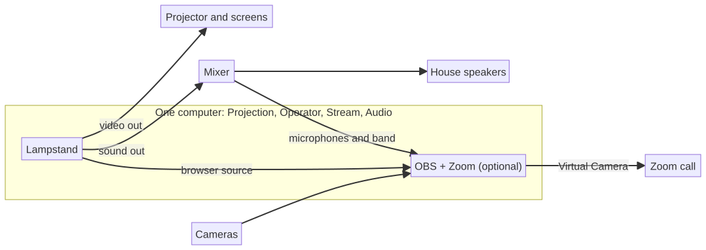
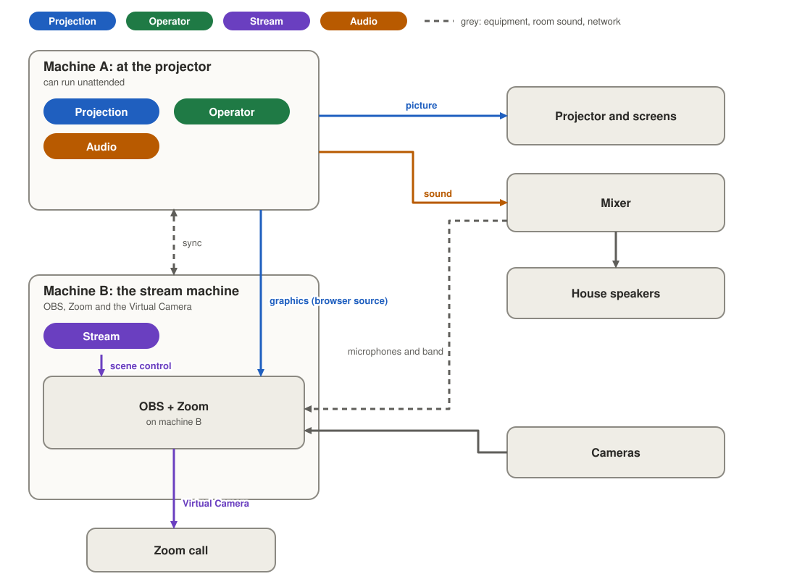
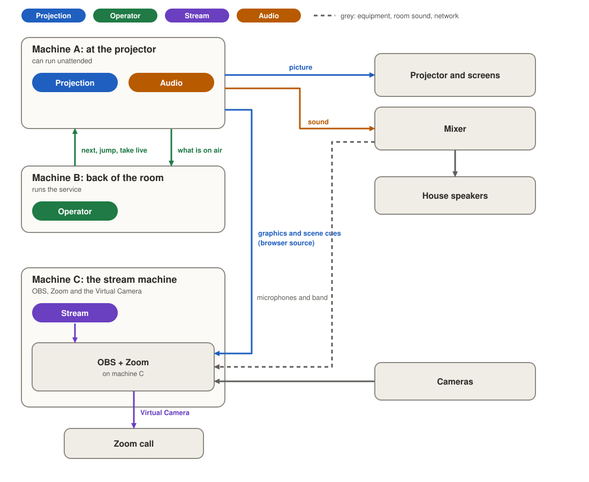
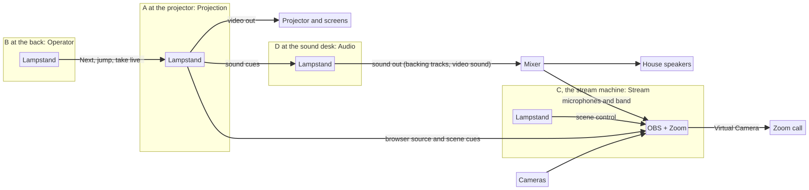

# Roles: who runs what

Status: built for 0.8.0, except the parts marked **Planned** (see "Built and planned" below). Decisions: [0010](decisions/0010-roles-and-handoff.md); the map is [issue 114](https://github.com/incrhst/lampstand/issues/114). Builds on the presenter lease ([0008](decisions/0008-presenter-lease.md)) and driving ([0009](decisions/0009-driving-another-device.md)), which became the Projection and Operator roles. The page for volunteers is [the Roles page on the website](../site/docs/roles.html). Ideas set aside for later are in [roles-future.md](roles-future.md).

A **role** is a job someone is doing right now. It is not a permission; who may do a job is the Teams work (T18).

The roles work is tested on macOS and Windows. Linux is not supported for now (PR #151 drops it from CI and releases); the roles code has no platform-specific part, but nobody checks it there.

## Built and planned

| Part | State |
| --- | --- |
| The four roles, asking, allowing, taking over, signed role records, the roster | Built (#128, #129, #130, #131) |
| Moving from 0.7.0, the Operator seat, "Hand the service back" | Built (#128, #129) |
| Stream holder owns OBS, OBS cues, the stream desk view | Built (#132, #133, #134) |
| Sound in the order of the service, Setup > Sound, playing, the output chooser, the panic stop | Built (#135, #136) |
| Waiting by the holder's takeover setting as well as one's own | Planned: open PR #160 (a new `Takeover` frame) |
| Settling a claim that the holder refuses (the "Reclaim" step) | Planned: proposal in issue #153 |
| "Send sound to the stream" (the OBS browser source plays Lampstand's sound) | Planned (#137); needs the OBS prototype (#125), which has not been run |
| A warning in the role bar that names the sound item that will not play | Planned (see "Audio warnings") |
| The tablet and phone remote, the browser stage page, a Stream view in the browser | Planned (decision 0006; not in the app yet) |
| Showing the volunteer that a role's record could not be checked | Planned (the state exists; nothing shows it) |

## The four roles

| Role | In plain words | What it owns | Needs |
| --- | --- | --- | --- |
| **Projection** | Runs the screens | Projector and stage screens, the live engine, the local server OBS reads | screens set up on that device |
| **Operator** | Runs the service | Next, previous, jump, take an item live | Projection held |
| **Stream** | Runs the stream | OBS scene, mutes, preview; OBS and Zoom | nothing |
| **Audio** | Runs the sound | The sound Lampstand plays: video sound, music-only items, backing tracks; the sound output | Projection, for new cues |

The people-facing words are "the screens", "the service", "the stream" and "the sound" (`app/src/lib/roles.ts`, `lampstand_sync::wording`). The names Projection, Operator, Stream and Audio are for developers and for this document.

**Projection is tied to the screens.** It belongs to the machine wired to the projector and screens, and does not move by itself. Only a device that has screens set up (a projector, a stage display, or its own display as an output) can hold it. The app tells the sync node whenever an output is turned on or removed (`SyncNode::set_screens`). On any other device the Take button is greyed out with "No screens are set up on this device". Moving Projection to another machine means that machine is connected to the screens, for example a backup laptop on the same projector switch. Pass it on only then.

**Projection can run unattended.** Nobody has to sit at the Projection machine. It opens its screens when Lampstand starts and keeps the service ready; the Operator, the stream and the planning happen on other devices.

All four have one holder at a time. A device may hold any mix. A device with no role still edits and syncs freely, as a planning device did in 0.7.0. A device with nothing paired holds all four, whatever an old record says, and shows no role words.

### What each role needs

- **Projection** depends on nothing. Without screens a device cannot take it.
- **Operator** needs Projection to be held by a device the Operator can reach. While the Projection holder is offline the Operator's controls wait and the seat is kept; they wake when the holder is back. The Operator seat cannot be taken or handed on while nobody holds Projection ("The service can't be run until someone runs the screens.").
- **Audio** can be held anywhere. It receives its cues (play, pause, stop) from Projection, so it starts nothing new without it; what is playing keeps playing and its stop stays on the Audio holder.
- **Stream** depends on nothing: the stream desk works if the house machine drops.

## Set-ups: one machine, two, three or more

You can start with one machine and add the others later. Nothing about the service changes; each role moves to another device by asking, except Projection, which stays with the machine wired to the screens.

### How to read the pictures

Each machine is a box and the roles it holds are the coloured pills inside it. A role has the same colour everywhere: **Projection blue, Operator green, Stream purple, Audio orange**. An arrow takes the colour of the role that owns it (blue for the picture and for graphics and scene cues, orange for sound, green for next, jump and "what is on air", purple for scene control and the Virtual Camera). Grey is equipment, room sound and the network; a dashed line is a link over the church network or a helper. The pictures are drawn by `diagrams/generate.py` (not changed by the build; see [diagrams/README.md](diagrams/README.md)). The website uses copies in `site/docs/diagrams/`.

### 1. One machine, all roles

One computer runs the screens, the service and OBS. It holds all four (automatically; nothing to set up). OBS and Zoom, if used, run on the same computer. The house sound is whatever that computer plays, so for Zoom use a mixer feed into the computer. Nothing is paired.

### 2. Two machines

- **Machine A, at the projector:** Projection, Operator and Audio. It can sit unattended; the service can be run from B.
- **Machine B, the stream machine:** Stream. Runs OBS, Zoom and the OBS Virtual Camera, and connects to its own OBS.

Pair B with A. A shows the pairing code and B types it; the device that showed the code takes Projection, Operator and Audio (if it has screens), and Stream is left unheld, so A keeps the OBS duty until B takes Stream. B presses Take on "Runs the stream"; A allows (and can say "Always allow this device"). Use a wired network with reserved addresses. B's OBS shows A's pictures through a browser source that reads A's network address.

To set that browser source up in one click, open Setup > OBS **on A**, put B's address in "Computer", save and test the connection, and press "Set up OBS" (it appears when OBS is on another computer). It makes a "Lampstand" collection in B's OBS with the scenes Slides, Worship and Pastor and slides, each showing a browser source named "Lampstand stream" whose address is A's network address, never `localhost`. "Use this address" pins which of A's addresses is used when A has several. This is the built form of the one-click setup: it runs on the machine that serves the pictures, not on the stream holder (the spec first said the stream holder; see "Where OBS lives").

Variant: B is a second operator laptop (Operator) and OBS stays on A.

### 3. Three machines

- **A, at the projector:** Projection, and Audio unless it moves. It can run unattended.
- **B, back of the room:** Operator (runs the service, sees what is on air).
- **C, stream machine:** Stream (OBS, Zoom, Virtual Camera).

Operator is disabled if A drops and wakes when Projection is held again. C keeps working without A, but scene changes wait for A (the stream desk says "{name} runs the screens and is offline. Scene changes wait for it.").

### 4. Four machines, with the sound desk

Where the mixer is far from the projector, add a machine at the desk that holds Audio. Backing tracks and video sound then play from there, straight into the mixer.

### Audio at the sound desk

Where the machine running the screens is far from the mixer, spin Audio off to a machine at the desk: its own laptop, or B or C above. That device takes Audio, and from then on Lampstand's sound plays from its output into the mixer. Projection keeps rendering and stays silent. Passing Audio stops whatever is playing, and the prompt says so.

### What comes from the house: cameras, microphones, the band

None of it goes through Lampstand, and no role owns it. Lampstand never carries camera video or sound from the room.

- **Cameras** belong to OBS. Plug them into the stream machine (USB or an HDMI capture box), or bring them in over the network (network cameras, NDI or RTSP) into OBS. Putting the stream machine near the cameras and the mixer is the simplest.
- **Microphones, the band and the house mix** come from the church's mixing board. Whatever the mixer sends has to reach the machine running Zoom and the OBS Virtual Camera. One common way, as an example and not a requirement: a feed from the board into a USB audio interface on the stream machine, used as the Zoom microphone (with "Original sound" on) and as an OBS audio source.
- **Lampstand's own graphics** reach OBS as the browser source, so the stream shows camera and graphics together, switched by the Stream holder.

### Sound that Lampstand plays

A video, a music-only item or a backing track has sound. It plays in the house, once, from the **Audio holder's** output (the machine running the screens unless Audio has moved). Pick the output in Setup > Sound ("Where the sound comes out"), so it goes to the mixer's interface and not the projector's. Changing the output stops what is playing. A chosen output that is not connected falls back to the computer's default, and the screen says so.

**Built (#136):**

- **Backing tracks.** A music-only item sits in the service on its own; a backing track is attached to a song. A song's backing track that "plays on its own" starts when the song goes live. A music-only item has no slides, so the live engine never takes it live: it plays when someone presses Play in the sound panel in Present ("In this service"). A sound set to "Waits for someone to press play" waits for Play whichever it is.
- **Controls.** Play, Pause, Resume, "Fade out" and the panic stop "Stop the sound now", in the sound panel of Present on any device (a request goes to whichever device holds Audio; Play, Pause, Resume and Stop count only from the devices that run the screens or the service, the panic stop from any paired device; it says "The device that runs the sound is not connected." if it is away). From a phone or tablet helper: **Planned**, since the remote is not built.
- **If Projection is away**, what is playing keeps playing and can still be stopped, but nothing new starts.
- **Files** travel by sync to every device that has the service (not only the Audio holder, because Audio can move), for services starting within the next 36 hours or that started less than 36 hours ago. Plan shows "File missing" on an item whose file is not on this device, and whether it is on its way.
- Count-in, a click for the band, and key or tempo changes are later features.

**Planned (#137): "Send sound to the stream"** (Setup > OBS, off by default). When it is on, the stream output's OBS browser source would also play that sound, and OBS would capture it, so the stream's sound and picture match and the Stream holder has OBS's own mute and fader for it. It needs a prototype first (ticket #125, "can the OBS browser source play Lampstand's sound through OBS?"), which has not been run. None of this exists in the app: there is no such switch, no "Not sent to the stream" effect (the per-item option "Don't send this sound to the stream" is stored and shown, and changes nothing yet), and Lampstand does not touch OBS's audio settings.

Until then, the mixer route is the way, and the lip-sync tip applies: delay the mixer source in OBS (Advanced Audio Properties, Sync Offset) until it matches the picture.

The rules planned for #137, for approval when it is built:

1. A music-only item is a scene with sound and no picture. With the option on, the stream output plays it as it plays a video's sound.
2. Every item has "Don't send this sound to the stream" (for copyright, or because the sound reaches the stream another way). It is off unless set. The house is unaffected.
3. Background music that runs under several items follows the item that started it, and stops with it, for the house and the stream alike.
4. If the stream output's page is not connected when a sound starts, the sound does not fall back to anything. The Stream holder's view says "Sound is not reaching the stream", and the house is unaffected.
5. With the option off, nothing changes: the stream hears whatever the mixer sends.
6. Do not do both. If the mixer already sends the computer's channel to the stream, leave the option off, or the sound doubles. The setup screen would say so.
7. **The one OBS audio exception** (decision 0010, point 8): Lampstand may set "Control audio via OBS" on its **own** browser source only, so OBS treats the page's sound as an audio source. It never changes another source, and never any other OBS audio setting. Today "Set up OBS" does not set it.

### Audio in the order of the service

Sound is part of the service, so it lives in the service order and syncs like the rest of the plan, whoever holds Audio. The Audio role only decides which device plays it.

- **Built.** A music-only item or a song's backing track has a name, a file, a length and "plays on its own" or "waits"; the order shows them, and the service heading shows the music-only total ("Sound: 12:30", or "at least" when a file gave no length). Any device can plan sound, with no role. **Setup > Sound > "Use sound in services"** (off by default) decides whether Plan offers the buttons that add sound ("Add sound", "Add a backing track"). Sound already in a service always shows, with the switch on or off. A church that never turns it on sees nothing about sound.
- **The Operator sees it.** Present lists the service's sound ("In this service"), what plays now with its position, and the controls above, whether Audio is on the same device or not. The roster says who runs the sound.
- **Moving Audio never edits the order.** The order is the plan; only the playing changes hands.
- **Older versions.** A Lampstand without sound cannot open a service with a music-only item; it says the service was saved by a newer Lampstand (details in ARCHITECTURE).

### Audio warnings

The spec wanted: "Nobody runs the sound, so {item} will not play." What is built is shorter and is shown in the sound panel when it applies: **"Nobody runs the sound."** (no device holds Audio), **"The device that runs the sound is not connected."** (the Audio holder is offline), a message when a sound failed to start, and "This computer's sound output is not working. Choose another in Setup > Sound." on the Audio holder. None names the item. The longer wording is **Planned** and is an open question (see the end).

**Stream warnings: none.** Nothing warns that nobody runs the stream, because with nobody on Stream the Projection holder keeps the OBS duty and nothing is lost. The one stream line is on the device that waits for the stream machine: "{name} runs the stream and is offline. OBS will catch up when it is back."

### Confidence screens and stage displays

A confidence screen (speaker's notes, next slide, clock) is not a role. It can be:

- **A second display on the Projection machine,** set up as a stage output. Today's way, limited by the cable run to the stage.
- **A browser page on any device** (a tablet on a music stand, a TV with a browser), opened from a QR code like the tablet remote. It would show what Projection is showing, never hold anything, and never affect the main screens if it drops off Wi-Fi. **Planned**: the browser stage page (PRD LV-5, PS-7; decision 0006) is built separately from the roles work and is not in the app yet.

A native stage output on a second Lampstand machine would be a later Stage display role ([roles-future.md](roles-future.md)).

### Phones and tablets

A phone or tablet in the browser is a **helper**: it acts for the device that holds a role, by sending Operator-type commands (next, previous, show, black, logo, clear) to the Projection machine, and later the panic stop for music. It never holds a role and does not appear in a seat. **Planned**: the tablet remote (pairing by QR code and PIN, decision 0006, tickets T99 to T101) is not in the app yet. Today a second laptop can run the service by holding the Operator role. A browser view for Stream is a later feature.

## How a role moves

The same rules for every role.

1. **Ask.** A device presses **Take** for a role. The current holder sees "Mary's laptop wants to run the stream." with **Allow**, **Not now** and, for Operator and Stream only, **Always allow this device**. It works only while the holder is connected. The asker sees "Waiting for {holder} to allow..." and then either holds the role, or "{holder} said not now." with **Ask again**.
2. **One ask at a time.** A holder answers one ask at a time. A second asker is not queued; it is told "{name} is already asking." with **Ask again**.
3. **Take over.** If the holder has been offline for the takeover time, or nobody holds the role, another device may take it after confirming ("Mary's laptop has been offline for 5 minutes. Run the stream from here?"). The takeover time is set on each device in Setup > Devices (default two minutes). A claimant also waits a **10 second margin** on top (`TAKEOVER_MARGIN`): with the default it can take over from 2 minutes 10 seconds of silence. Until then the button explains how long is left. A short network drop never counts. Open: PR #160 makes the claimant wait by the longer of its own setting and the one the holder tells it (**Planned**); until it lands each device uses its own setting.
4. **What is on air.** Passing **Projection** clears the screens ("Allow and clear the screens"), and passing **Audio** stops what is playing ("Allow and stop the music"). Passing **Operator** leaves the slide up. Passing **Stream** leaves OBS on its current scene.
5. **A returning holder yields.** A device that comes back after losing a role learns it, drops the role and shows a notice ("Mary's laptop took over running the stream while this device was offline. This device no longer runs the stream."). It cannot win the role back by itself.
6. **Always allow** is offered only for Operator and Stream. It is not offered for Projection or Audio, because handing either over clears something on air. It is remembered per device, listed in Setup > Devices ("Always allowed", "Stop always allowing {name}").
7. **Roles are independent.** Handing Projection to another device does not move the Operator seat or Audio. The Operator seat is kept across a Projection hand-over, and the new Projection holder announces its state to the Operator.
8. **The Projection holder takes the Operator seat back whenever it likes,** without being allowed. The Operator sees "{name} took back running the service. This device no longer runs the service."
9. **"Hand the service back"** is the Operator's own button (it was "Stop driving" in 0.7.0). It gives the seat to the Projection holder, which takes it. It is silent: no notice on either side. If the Projection holder is not connected, the seat is simply let go and nobody holds Operator.

Who may hold a role is checked in one place, `Roles::claim` and `Roles::allow` (`check_teams`). Today it always says yes; Teams (T18) will plug in there.

### Signed role records

Each role is a record `{ holder, name, epoch }` with the last **eight** signed steps that led to it (a claim, a hand-over or a release, each signed by the device that did it). A device takes in a newer record only if its steps join the state it has and were signed by devices it knows, so a stranger cannot invent a hand-over. A record that cannot be joined (a device missed more than eight steps) is kept aside as **unverified** until a record that joins arrives, or until the device is paired again (unpair, pair). A device that lost its role file is taught again by the devices it is paired with.

**What the volunteer sees: nothing yet.** The unverified state is reported in the sync status for each role but no screen shows it. A device in that state keeps what it had; the cure is to unpair and pair again. Showing it is **Planned**.

**Known gap (issue #153):** if the link failed in one direction only, or devices dropped at different times, a claim the holder refuses can leave the claimant believing it holds the role while the holder does too, until a later record moves one of them. The margin and PR #160 narrow it; the "Reclaim" proposal in the issue would settle it. Not built.

### Defaults, restarts, moving from 0.7.0

- **Pairing.** The device that shows the pairing code takes the roles nobody holds: Projection, Operator and Audio, each only if the rules allow. **A first device with no screens gets none of the three** (Audio goes only with Projection). Stream is left unheld, so Projection keeps the OBS duty until someone takes Stream.
- **Restarts.** Roles are kept in `roles.json` beside `paired.json`, device-local, and when each paired device was last heard is kept in `contact.json`. A restart, crash or sleep leaves a holder that others see as offline; the takeover time applies.
- **Moving from 0.7.0.** A device reads `presenter.json` and `driver.json` once into `roles.json` and leaves the old files. The lease becomes the Projection record with its epoch and takeover time. **Operator and Audio go to the Projection holder,** at the same epoch. The "always allowed to drive" list becomes Operator's. Stream is unheld. Sync protocol 5; a device on 0.7.0 (protocol 4) is refused with the usual message saying which side should update.
- **Roster.** The status bar shows what this device runs ("Runs the screens and the service") and who runs the rest ("Mary's laptop runs the stream"); a device with no role says "Planning". "Presenting" and "Driving" are gone. Setup > Devices has the "Who runs what" panel, with each role, who has it, a Take button, the always-allowed devices and the takeover time.

## Where OBS lives

- OBS is connected from the **Stream holder**. On a stream machine that is OBS on that machine, so the OBS password stays there.
- When an item goes live, Projection sends its scene as a cue (a scene name or nothing; no address, password or path) to the Stream holder. If the Stream holder is offline the newest cue waits and applies when it returns (a newer cue replaces an older one); Projection never switches OBS itself while Stream is held, so there are no double switches.
- With nobody holding Stream, Projection keeps the OBS duty, as it did in 0.7.0. A device with nothing paired drives its own OBS.
- The OBS drawer, scene follower, preview and mutes run on the Stream holder. On a device that does not own OBS, Present shows no OBS strip, and a scene or mute picked by hand says "OBS is run by the device that runs the stream." Setup > OBS works everywhere, so a machine can be set up before it takes Stream.
- A **stream desk** (a device that runs the stream, not the service or the screens, with other devices paired) shows OBS in Present even with no service open, and keeps the Present keyboard shortcuts off there, so Space and Enter go to the focused OBS button.
- "Set up OBS" and "Use this address" (Setup > OBS) appear when OBS is on another computer. They only touch the "Lampstand" collection and the scenes and browser source it makes; they refuse to run while OBS is streaming or recording.
- Lampstand never edits OBS's settings otherwise (it can start OBS minimised). The one planned exception is "Control audio via OBS" on its own browser source (#137, above).

## Decided during the build

These were proposed in the first design and are now decided, or were decided by the owner while the roles were built:

- Projection holder retakes Operator unasked; "Hand the service back" is a silent hand-back.
- Moving from 0.7.0 gives Operator and Audio to the Projection holder; a first device with no screens gets none of the three.
- Roles are independent on a Projection hand-over.
- A claimant waits the takeover time plus 10 seconds.
- One ask at a time; always-allow only for Operator and Stream.
- Role records are signed, eight steps, with an "unverified" state.
- Stream warnings: none. Audio warning: "Nobody runs the sound." (wording question open).
- Setup > Sound "Use sound in services" off by default.
- The OBS audio exception is planned, not built.
- **Teams check.** Who may hold a role is decided at `Roles::claim` and `Roles::allow` and nowhere else (T18).
- **Sound.** Room sound (microphones, the band) stays outside Lampstand and outside the roles. NDI audio is a later ticket.
